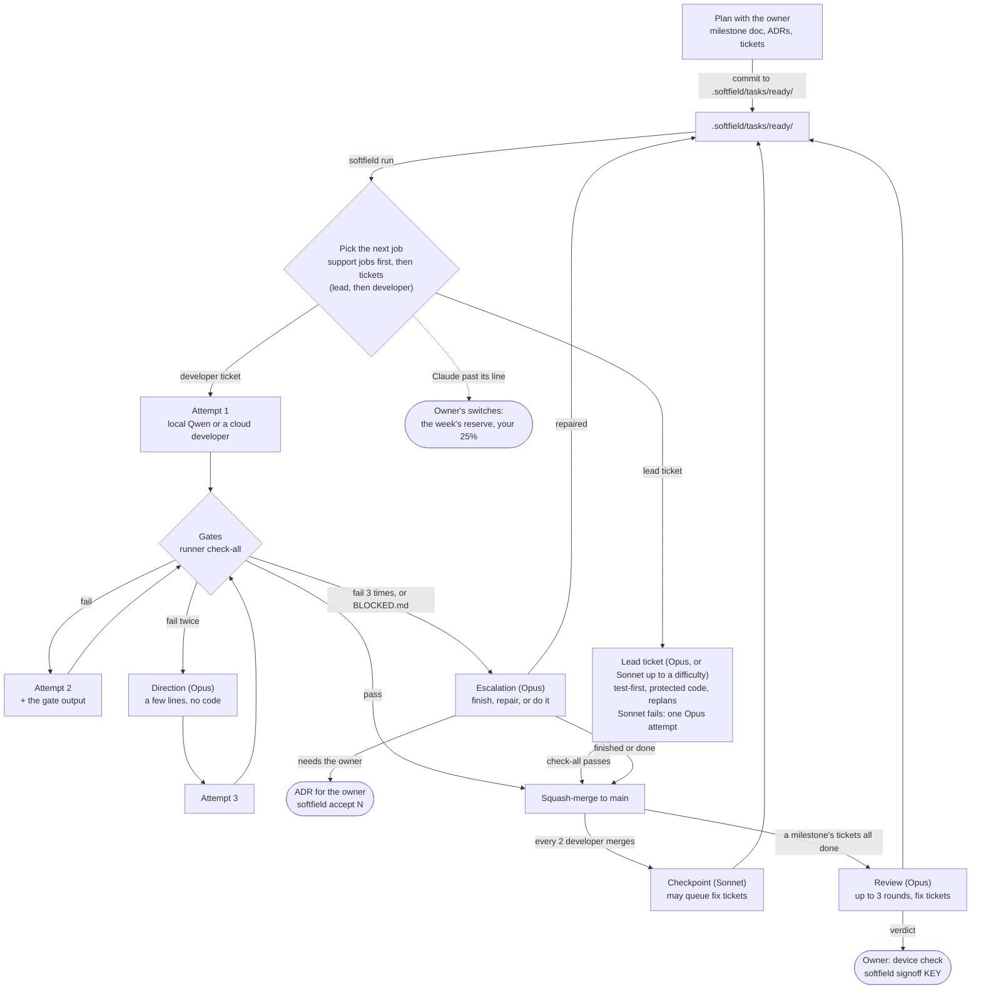

# How the frontier + local workflow works

A plain-language overview. The rules are in [`workflow.md`](workflow.md) and [`task-format.md`](task-format.md), and the craft of writing tasks is in [`task-writing.md`](task-writing.md).

## The whole flow



- **Checkpoints** run after every 2 *developer* merges, counted across all milestones (`checkpoint_every` in `.softfield/project.toml`). Lead-ticket merges don't count.
- **Reviews** run when every ticket of a milestone is in `done/` (set-aside ones in `later/` don't count), before the runner's next ticket ([ADR 17](../.softfield/adr/17-always-on-factory.md)).
- **A replan is a lead ticket,** written at planning after a chain of three or more lead tickets that later ones rely on (`docs/agents/lead.md`, "Replans"). The runner never makes one itself.
- **Owner questions:** ADRs and sign-off. The reserve switches replace the console's y/N once F8 lands ([ADR 22](../.softfield/adr/22-one-visible-queue.md)).

**The idea** ([ADR 07](../.softfield/adr/07-spend-less-frontier.md)): the frontier model is the tech lead and the local models are its developers. The lead designs, decides how the pieces connect, writes short tickets and builds the security-critical parts. The developers write the rest, tests included. Deterministic gates check every change, and the lead reviews once per milestone. Until M3 the lead also wrote a working solution for every task, which cost more than doing the task; that's gone.

## The queue

It's just folders of Markdown task files, with no database or server:

```
.softfield/tasks/ready/      waiting to run
.softfield/tasks/done/       merged, with a result footer the runner appends
.softfield/tasks/escalated/  the local model failed 3 times, or pre-flight failed; waiting for the frontier
.softfield/tasks/blocked/    past its limits, or waiting for the owner; the verdict names it
```

The owner starts a whole milestone with `softfield milestone N` ([ADR 12](../.softfield/adr/12-junior-feedback-and-checkpoints.md)): it works through the queue, runs the review, and ends with a verdict, either ready for sign-off or exactly what needs the owner. Underneath, it loops over the queue:

1. **Pick** the lowest id in `ready/` whose `depends_on` tasks are all in `done/`.
2. **Branch** `task/<id>` from main.
3. **Pre-flight.** Every file path in backticks in the spec must exist (or be one the task creates), and every quoted `class`/`def` must be found in those files. If not, the task escalates straight away without spending model time.
4. **Local model.** A one-token warm-up request makes LM Studio load Qwen with the owner's settings. Then OpenCode runs with a short prompt: the rules, the task, and the commands to finish with.
5. **Gates**, stopping at the first failure:
   - no protected paths touched (including the tests that guard security code)
   - no test skipped or xfailed
   - no new dependencies
   - diff under a 1000-line backstop
   - test layout
   - translations
   - ruff
   - mypy
   - the task's own tests
   - the whole suite, minus other queued tasks' tests
   - the tests the task added or changed fail against main's code, so they really test the change
6. **Pass:** squash-merge into main and move the spec to `done/`. **Fail:**
   - attempt 2 continues on the same branch, with a one-line hint and the gate output at the end of the prompt;
   - before attempt 3, unless the failures were mechanical, the lead reads the work and the developer's thinking and writes a short direction (no code);
   - attempt 3 starts from a fresh branch, with that direction last;
   - after 3 failures, the spec moves to `escalated/`.

   Every two developer merges, a short **checkpoint** review looks at what just merged and steers the next tickets. The lead's own tickets (`agent: lead`) run in the same queue, done headlessly and merged only when every check passes.
7. **Escalation:** the headless frontier model, at most twice per task. It repairs or splits the spec, adds missing facts, does the task itself, or drafts an ADR for the owner. Its code must pass every check, or it stays on a branch. The runner commits its changes and moves the file.
8. **Session report:** written to `.softfield/sessions/` at the end.

After a milestone's tasks are done, the review loop (`softfield review --milestone N` on its own) runs the staging end-to-end tests and a headless review. Blocking and should-fix findings become fix tasks or direct fixes, and nits become set-aside bug tickets, or are said in the report. The loop stops on the rules in `workflow.md`.

Everything is plain git and files, so a bad run is easy to inspect (logs go in `.softfield/var/runs/`) or undo.

## What goes in a ticket

A goal, the files to read, the worked example to follow, and acceptance criteria as bullets, including the edges. No pasted code and no working solution: the developer reads the code and writes the tests itself. Security work is the exception: the lead writes those tests first, on main. Details: [`task-format.md`](task-format.md).

What the developers learn stays in the repo, since they have no memory: a check where possible, else a worked example, else one line in [`docs/agents/developer.md`](agents/developer.md) (15 lines at most).

## Results so far

M1 proper: 3 tasks, all passed on the first attempt, each taking about a minute of local model time and a few seconds of gates, with no frontier usage. The two calibration failures before that were spec errors, fixed by [ADR 01](../.softfield/adr/01-calibration-fixes.md). See `.softfield/reviews/m1.md`.
